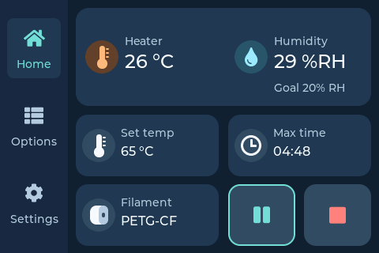
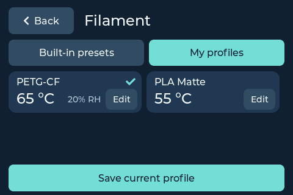
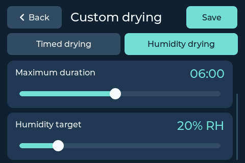
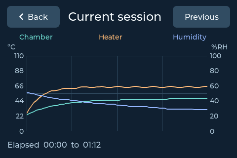
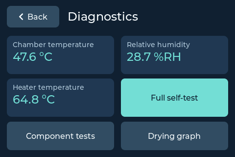

# ELEGOO H1 HT Custom Firmware

Full replacement firmware for the **ELEGOO H1 HT filament dryer**. Run the dryer from its built-in touchscreen, save a program for each filament, and see how temperature and humidity change during a cycle.

**[Install the firmware](#install) · [Explore the features](#what-you-can-do) · [Build from source](#build-from-source) · [Join the community](#join-the-community)**

<p align="center">
  
</p>

## What you can do

- **Dry by time or humidity.** Set a duration or choose a relative humidity target with a maximum run time. Pause or resume a cycle from the touchscreen.
- **Save your filament settings.** Choose from 12 built-in presets or use **Save current profile** to store the active temperature, duration and optional humidity target. Keep up to eight named profiles and adjust temperature quickly from Home.
- **See how a cycle is going.** Track chamber temperature, heater temperature and relative humidity for the current or previous session. A saved cycle can be resumed after a restart.
- **Control the dryer from the touchscreen.** Adjust spool rotation, lid detection, manual fan speed, screen timeout and which events make a sound.
- **Troubleshoot on the device.** Check live sensor readings, run component tests and review a persistent error log.

<p align="center">
  
  
  <br>
  
  
  <br><sub>Beta 0.17 touchscreen previews with example readings.</sub>
</p>

[Browse all screenshots](docs/screenshots/) · [Read the Beta 0.17 notes](docs/beta-0.17.md)

## Install

**Supported hardware** · ELEGOO H1 HT with mainboard **SPA001-MB V1.2** and microcontroller **GD32F303VET6**.

The firmware is in beta. Physical validation of heating, fault handling and recovery is ongoing.

1. First update the dryer to the official firmware **v1.2.5**. Download the [official v1.2.5 firmware ZIP](https://wiki.elegoo.com/h1-ht/h1_ht_dryer_mcu_elegoo_spa001__v1.2.5.zip), prepare a FAT32 microSD card with the files from the ZIP, then follow [ELEGOO’s firmware update guide](https://wiki.elegoo.com/en/filament-dryer/h1-ht/firmware-update-guide). Unplug the dryer before opening the bottom cover.
2. After the official update, check **Settings → About** and confirm the firmware version is **v1.2.5** before continuing.
3. Get the custom firmware update ZIP from **Releases** when a packaged build is available, or [build it from source](#build-from-source). Read the notes for the version you install. [GitHub Releases](https://github.com/lukashilverda/elegoo-h1-ht-custom-firmware/releases)
4. Extract `ELEGOO_DryerBox.bin` from the custom ZIP to the root of an empty FAT32 microSD card. This is the only file needed for the custom update. Follow the same update guide to install it.
5. Stay with the dryer during your first test cycle.

### Return to factory firmware

Keep a copy of the [official v1.2.5 firmware ZIP](https://wiki.elegoo.com/h1-ht/h1_ht_dryer_mcu_elegoo_spa001__v1.2.5.zip). To return to the factory firmware, prepare the card with the files from that ZIP and follow [ELEGOO’s firmware update guide](https://wiki.elegoo.com/en/filament-dryer/h1-ht/firmware-update-guide).

## Join the community

**Give the repo a ⭐** if you use the firmware or want to follow the project. To get notified about new builds, use **Watch → Custom → Releases**.

- **Request a feature.** Tell us what you want to do on the dryer and when it would help. [Open a feature request](https://github.com/lukashilverda/elegoo-h1-ht-custom-firmware/issues/new?title=Feature%20request%3A%20)
- **Share your experience or report a bug.** Tell us which firmware version you used, what you tried and what happened. A photo or an error code helps when you have one. [Browse issues](https://github.com/lukashilverda/elegoo-h1-ht-custom-firmware/issues)
- **Contribute a change.** Pull requests for firmware fixes, touchscreen improvements, tests and documentation are welcome. For larger changes, open an issue so we can discuss the approach. [Pull requests](https://github.com/lukashilverda/elegoo-h1-ht-custom-firmware/pulls)

## Development and license

The firmware is written in C++17 and uses LVGL 8.3.11. It includes host tests for cycle logic and settings, a touchscreen preview, and register-level emulation for the ARM firmware.

The project source is MIT-licensed. [MIT License](LICENSE)

### Build from source

On Linux or WSL, install GNU Make, Git, GNU binutils, Python 3 and a C++17 compiler. For the device build, install the `arm-none-eabi` GCC toolchain and newlib with `libc_nano`.

Run these commands from the repository root.

```sh
git clone --depth 1 --branch v8.3.11 https://github.com/lvgl/lvgl.git lvgl
cd firmware
make test
make preview
make package
```

The update package is written to `firmware/build/ELEGOO_H1_HT_Beta_0.17.zip`. `make test` runs the cycle and journal tests and only needs the host tools. `make preview` writes framebuffer screenshots to `firmware/build/`.

Set `LVGL_DIR` on the Make command line if LVGL is installed elsewhere. Use `NEWLIB_SYSROOT` if your newlib headers and libraries are installed in a separate sysroot.

With Unicorn 2.1.4 installed, run the register tests from `firmware/`.

```sh
python3 hardware_test.py build/h1ht-beta-0.17.bin
```
